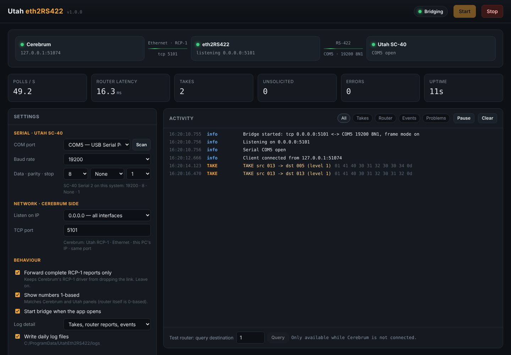

# Utah eth2RS422

A small TCP ⇄ RS-422 bridge that lets **EVS Cerebrum** control a **Utah Scientific SC-40 / UDS** router reliably over its serial RCP-1 port, with a built-in web UI for settings, status and a live activity log.

```
Cerebrum ──TCP (Utah RCP-1, Ethernet)──▶ Utah eth2RS422 ──RS-422──▶ SC-40 Serial 2 ──▶ UDS-144
                                         http://localhost:8422
```



Project page (public download): https://smasher.be/tools/utah-eth2rs422/

## Why this exists

Connected straight to the SC-40 over a USB RS-422 adapter, Cerebrum's *Utah RCP-1* driver worked but kept dropping the link every one to five minutes (Active → No Connection → "No Connection Active" → Active). Testing showed:

* The SC-40 and the wiring are fine: thousands of polls with zero timeouts or checksum errors.
* The drops depend on **how the router's replies arrive**. When a reply reaches Cerebrum in several pieces (normal for USB serial adapters), the driver eventually gives up. When every reply arrives whole, the link stays green.

The bridge waits for each complete RCP-1 report (terminated by `US`, 0x1F) and hands it to Cerebrum in one piece, immediately. Cerebrum then talks to it over TCP using the same Utah RCP-1 driver, with Router Connection set to Ethernet.

## Quick start (Windows)

1. Install Python 3.10+ from python.org and tick "Add to PATH".
2. Download or clone this repo, then double-click **`start_eth2rs422.bat`**.
   It installs `pyserial` on first run, starts the bridge and opens **http://localhost:8422**.
3. In the web UI, pick the COM port of the RS-422 adapter, check **19200 · 8 · None · 1**, and click **Save & apply**.
4. In Cerebrum, edit the router device:

   | Field | Value |
   |---|---|
   | Router Type | Utah RCP-1 |
   | Router Connection | **Ethernet** |
   | Primary IP Address | `127.0.0.1` (same PC) or the bridge PC's IP |
   | Advanced Comms → Port Number | **5101** (must match the UI) |
   | Allow inactive comms | unchecked |
   | Advanced Configuration | Max Levels 1, Sources 144, Destinations 144 |
   | Retrieve Mnemonics / Locks, Re-assert Routes | unchecked |

The status strip should go green from Cerebrum to eth2RS422 to the SC-40, with polls flowing.

A standalone **`UtahEth2RS422.exe`** (no Python needed) is built by GitHub Actions on every push. Download it from the repo's *Actions* tab (artifact) or from *Releases* for tagged versions.

### Start automatically at logon

```powershell
powershell -ExecutionPolicy Bypass -File tools\install_autostart.ps1
```

This uses the exe in `dist\` if present, otherwise Python. To remove it: `Unregister-ScheduledTask -TaskName "Utah eth2RS422" -Confirm:$false`.

## Web UI

* **Signal path:** Cerebrum client, bridge and SC-40 serial status, with live indicators.
* **Counters:** polls/s, router response latency, takes, unsolicited router reports, errors, uptime.
* **Settings:** COM port (with rescan), baud/data/parity/stop, listen IP (all interfaces, localhost, or a specific NIC) and TCP port, frame mode, 1-based numbering, autostart, log detail, daily log files.
* **Activity log:** decoded RCP-1 (`TAKE src 004 → dst 006 (level 1)`), filterable by takes, router reports, events and problems. Raw hex is shown alongside.
* **Test router:** sends a single status query straight to the SC-40. It's only enabled while Cerebrum is disconnected, so it never disturbs live control.

Settings are stored in `%APPDATA%\UtahEth2RS422\config.json` and logs in `%APPDATA%\UtahEth2RS422\logs\` (kept for 14 days). The web UI listens on `127.0.0.1:8422` by default. Change `ui_host` in the config to `0.0.0.0` to reach it from other machines.

Command line: `python run_eth2rs422.py [--no-browser] [--stopped] [--config PATH] [--ui-port N] [--ui-host IP]`

## Wiring: SC-40 Serial 2 (RS-422) to a 4-wire RS-422 adapter

The SC-40's internal jumper JP2 must be set to RS-422. The pinout is from SC-40 guide Table 3-4.

| Adapter | SC-40 DB9 pin | SC-40 signal |
|---|---|---|
| T+ | 3 | RX+ |
| T− | 8 | RX− |
| R+ | 7 | TX+ |
| R− | 2 | TX− |
| GND | 5 | GND |

Adapters label polarity differently (A/B vs +/−). If nothing answers, swap T+/T− first.

**Serial settings that actually work on this SC-40:** Serial 2 = **19200 8N1**, not the 7E2 the manual lists as default.

## Tools

`tools/sc40_rcp1_sweep.py` is a read-only diagnostic (it only ever sends `ESC L` status requests):

```
python tools\sc40_rcp1_sweep.py COM5 sweep      # find baud/framing that answers
python tools\sc40_rcp1_sweep.py COM5 dump       # full matrix status, outputs 000-143
python tools\sc40_rcp1_sweep.py COM5 listen     # watch unsolicited router reports
python tools\sc40_rcp1_sweep.py COM5 soak       # poll like Cerebrum and count failures
```

Stop the bridge first, since only one program can open the COM port.

## Development

```
pip install -r requirements.txt
python -m unittest discover -s tests -v
```

`tests/test_bridge.py` runs the whole path end to end on Linux/macOS with a pseudo-terminal: a fake Cerebrum, the bridge, and a fake SC-40 that deliberately fragments every reply. It checks that every reply reaches the client whole.

More background is in [docs/NOTES.md](docs/NOTES.md).
